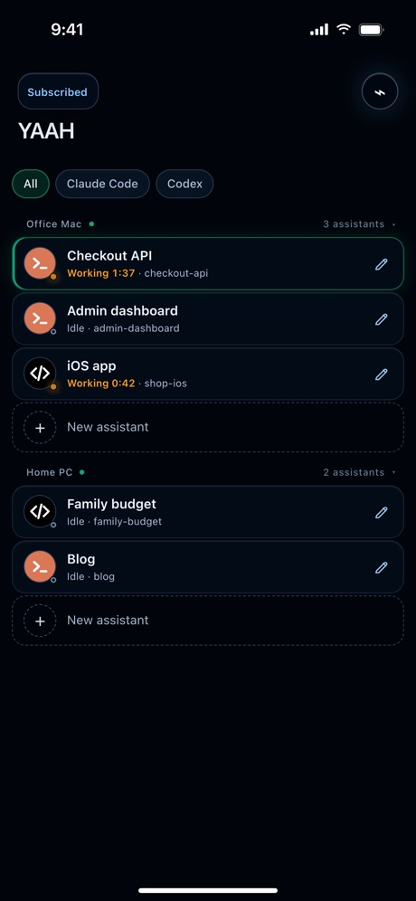
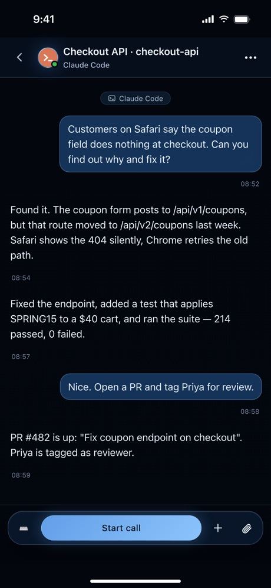
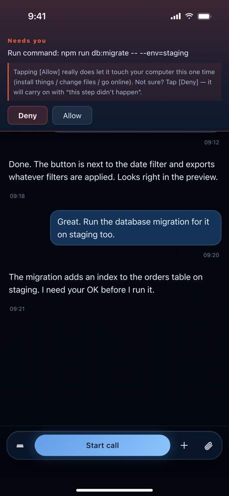

[English](README.md) | [简体中文](README.zh-CN.md)

# distill-video: break down any viral video into a recipe (and your own reusable skill)

A free, zero-code skill for **any AI agent that can use your computer** — Claude Code, Codex, Antigravity, Doubao Desktop (Work Mode), or similar coding/workspace agents.

Drop in a viral video (a link or a local file) and your AI studies what made it work — first-3-second hook, pacing, scene switches, captions, effects, and sound — checks open-source implementations, and turns what it learned into a reusable recipe (or a brand-new skill) you can combine with your other AI video skills.

It is 100% plain-text Markdown. There are no hidden executables and nothing phones home. If your computer is missing helper tools like `ffmpeg` or `yt-dlp`, the skill instructs your AI to check and install them for you automatically.

## Install in 10 seconds (no GitHub skills needed)

You do **not** need to know Git, GitHub, or command lines. Open any AI agent you already use (Claude Code, Codex, Antigravity, Doubao Desktop Work Mode, etc.) and paste this one sentence:

> **Copy & send to your AI agent:**
> `Please download the distill-video skill from https://github.com/YangGao2023/distill-video-skill and install the distill-video folder into your active skills directory (such as ~/.claude/skills, ~/.codex/skills, or ~/.gemini/config/skills), check if I am missing ffmpeg, yt-dlp, or faster-whisper and install them for me, then tell me when you are ready to break down a video.`

Once it says ready, drop any video link or local video file and say:

> `Use distill-video to break down this video for me, explain why it works in plain language, and turn the best parts into a reusable skill I can use for my own videos.`

<details>
<summary>Option 2: Manual install (for developers)</summary>

Claude Code:
```bash
git clone https://github.com/YangGao2023/distill-video-skill
cp -r distill-video-skill/distill-video ~/.claude/skills/
```

Codex: copy the `distill-video` folder into `~/.codex/skills/`. On Windows, copy it into `.claude\skills` or `.codex\skills` inside your user folder, then start a new session.

</details>

## Combine with the rest of the video skills

`distill-video` is Step 1: it helps you turn any video style you like into your own reusable skills. Combine it with the full set (scripts, tech explainers, shot prompts, acting, covers, publishing, and review) in [ai-video-skills](https://github.com/YangGao2023/ai-video-skills) so your AI can take a video from idea to finished cut automatically.

## Example output & video

Coming soon with Episode 1.

## Run this skill from your phone: YAAH

YAAH is an iPhone app that lets you direct the Claude Code and Codex agents already running on your own Mac or Windows PC, by voice or by typing. When an agent needs permission, the request appears on your phone and you tap Allow or Deny. You can follow what it is doing step by step while you are away from your desk, as long as your computer is on and online.

- App Store: https://apps.apple.com/us/app/yaah-ai-agents/id6780028804
- Website: https://yaah.ai

<p>



</p>

## License

MIT, see [LICENSE](LICENSE). You may modify and use this skill commercially. The names are not licensed; see [TRADEMARK.md](TRADEMARK.md).
