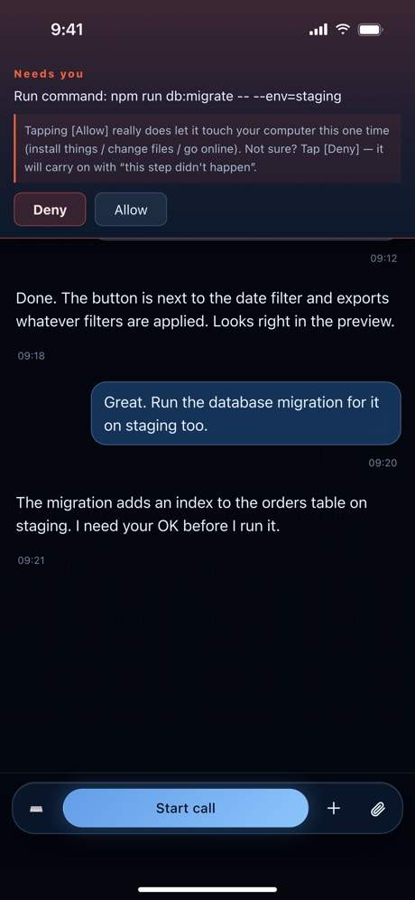

[English](README.md) | [简体中文](README.zh-CN.md)

# distill-video：把任何一条爆款视频拆成配方，变成你自己的 AI 技能

给**任何能帮你操作电脑的 AI 智能体**用的免费技能——不管你用的是**豆包电脑版（办公任务 / 本地电脑）**，还是 **Claude Code、Codex、Antigravity**，全部通用。

把你刷到的爆款视频（链接或本地文件）丢给 AI，它会自动把人家为什么抓人扒明白——前 3 秒怎么开场、多久换一次画面、字幕和弹卡怎么配合、声音和节奏怎么卡点——再帮你找现成开源做法，最后直接整理成**你自己的可复用技能**，搭配其他做视频技能，就能让 AI 一步步替你做出同款质感的视频。

全部是人眼能看清的纯文字说明书，没有隐藏脚本，不往外发数据。如果电脑缺工具，技能会自动教 AI 替你检查并装好，零代码基础也能直接用。

## 不会操作？10 秒让你的 AI 自动装好（零基础推荐）

你完全**不用懂 GitHub、不用自己找下载按钮、也不用敲一行代码**。

打开你电脑上任意一个能干活的 AI 助手（例如**豆包电脑版**切到「办公任务 + 本地电脑」，或 **Claude Code / Codex / Antigravity**），直接复制下面这句大白话发给它：

> **复制发给你的 AI：**
> `帮我从 https://github.com/YangGao2023/distill-video-skill 下载并把 distill-video 技能装进你正在用的技能目录（比如 ~/.claude/skills、~/.codex/skills、~/.gemini/config/skills，如果是豆包电脑版就帮我准备好压缩包并告诉我点哪里上传），顺便检查我电脑缺不缺 ffmpeg、yt-dlp 或 whisper，缺就帮我装好，装完告诉我。`

等 AI 说装好之后，把你想学的爆款视频链接贴给它（或把视频文件直接拖进对话框），再发一句：

> `用 distill-video 帮我拆解这条视频，用大白话告诉我它为什么好看，再把里面好用的套路整理成我自己的可复用技能。`

<details>
<summary>方式二：手动安装（给熟悉命令行的开发者）</summary>

Claude Code：
```bash
git clone https://github.com/YangGao2023/distill-video-skill
cp -r distill-video-skill/distill-video ~/.claude/skills/
```

Codex：把 `distill-video` 文件夹复制到 `~/.codex/skills/`。Windows 复制到用户目录下的 `.claude\skills` 或 `.codex\skills`，新开对话即可。豆包电脑版也可在侧边栏「技能 → 我的技能 → 上传技能」直接拖入 `distill-video` 文件夹。

</details>

## 组合整套技能，让 AI 全自动做片

`distill-video` 是起点：用它不断拆解你喜欢的风格，慢慢攒出一套你自己的技能；再搭配我们开源的整套视频技能（科技讲解、剧本、分镜、表演、后期、封面、发布、复盘），见 [ai-video-skills](https://github.com/YangGao2023/ai-video-skills)。

## 效果示例与视频

随第 1 期视频一起补上。

## 在手机上用这个技能：YAAH

YAAH 是一个 iPhone App，让你用语音或打字，指挥你自己 Mac 或 Windows 电脑上正在运行的 Claude Code 和 Codex。AI 需要权限时，请求会出现在手机上，你点允许或拒绝。只要电脑开着、连着网，你不在电脑前也能一步步看它在做什么。

- App Store：https://apps.apple.com/us/app/yaah-ai-agents/id6780028804
- 网站：https://yaah.ai

<p>



</p>

## 许可证

MIT，见 [LICENSE](LICENSE)。可以修改、可以商用；名字不在许可范围内，见 [TRADEMARK.md](TRADEMARK.md)。
