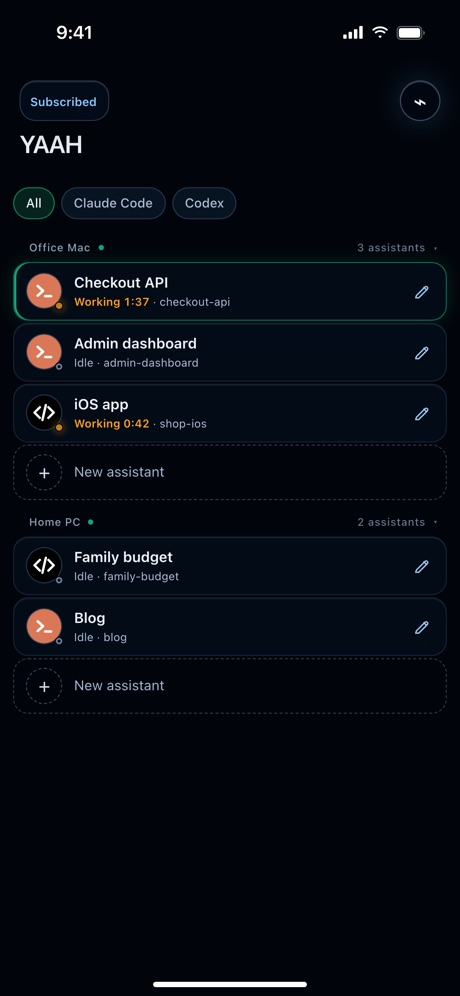
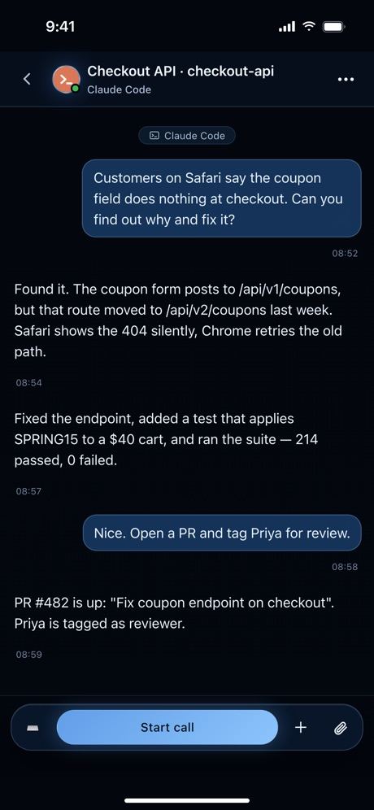

[English](README.md) | [简体中文](README.zh-CN.md)

# distill-video:把任何一条爆款视频拆成你能照着做的配方

给 Claude Code 和 Codex 用的免费技能。把一条视频(链接或本地文件)交给你的 AI,它会拆成一份能照着做的说明:头 1 秒、3 秒、12 秒发生了什么,故事怎么搭的,画面和声音怎么做的——配色、字体、字幕、特效、转场、节奏、配乐和音效。然后它会去找已经做好这些效果的开源工具,让你照这个风格做自己的视频,不用瞎猜。

全是文字,没有要运行的脚本,也不往外发任何数据。AI 用的是你电脑上本来就有的工具,比如 ffmpeg 和语音转文字。

## 效果示例

随这个技能的视频一起补上。

## 视频

即将发布。

## 安装

Claude Code:

```
git clone https://github.com/YangGao2023/distill-video-skill
cp -r distill-video-skill/distill-video ~/.claude/skills/
```

Codex:把同一个文件夹复制到 `~/.codex/skills/`。Windows 上复制到用户目录下的 `.claude\skills` 或 `.codex\skills`。新开一个对话,直接用大白话说,比如「帮我拆一下这条视频:<链接>」。

## 更多技能

这个技能是一整套 AI 做视频技能里的一个:剧本、分镜提示词、表演、剪辑、封面、发布、复盘。见 [ai-video-skills](https://github.com/YangGao2023/ai-video-skills)。

## 在手机上用这个技能:YAAH

YAAH 是一个 iPhone App,让你用语音或打字,指挥你自己 Mac 或 Windows 电脑上正在运行的 Claude Code 和 Codex。AI 需要权限时,请求会出现在手机上,你点允许或拒绝。只要电脑开着、连着网,你不在电脑前也能一步步看它在做什么。

- App Store:https://apps.apple.com/us/app/yaah-ai-agents/id6780028804
- 网站:https://yaah.ai

<p>



</p>

## 许可证

MIT,见 [LICENSE](LICENSE)。可以修改、可以商用;名字不在许可范围内,见 [TRADEMARK.md](TRADEMARK.md)。
